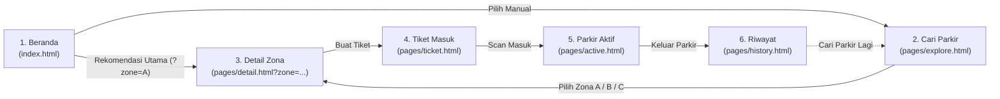
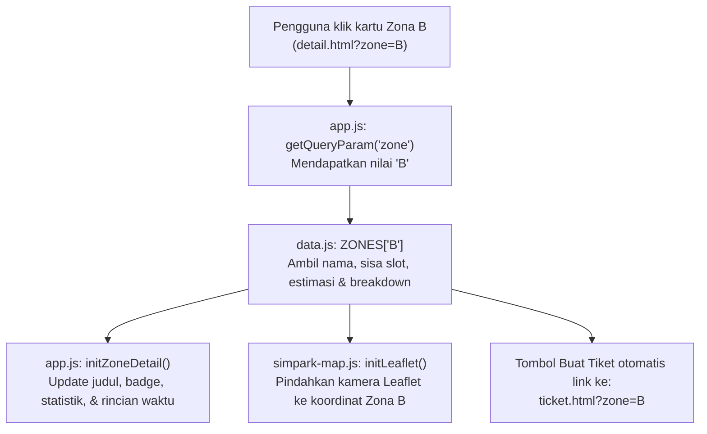

# SIMPARK-UB — Smart Parking Universitas Brawijaya

Prototipe web interaktif sistem rekomendasi & pemantauan parkir cerdas di lingkungan kampus **Universitas Brawijaya (UB)**. Proyek ini dikembangkan untuk keperluan tugas mata kuliah **Interaksi Manusia dan Komputer (IMK)** berdasarkan desain antarmuka Figma.

---

## 🚀 Cara Menjalankan Proyek

Proyek ini adalah **aplikasi web statis modern (Vanilla HTML5, CSS3, JavaScript ES Modules, dan Bootstrap 5 via CDN)**:
- **Tanpa instalasi Node.js atau `npm install`**.
- **Tanpa build-step** (tidak perlu Webpack/Vite).
- **Semua fungsi callback ditulis dengan blok function standar**, tanpa arrow function/lambda.

### Menjalankan Langsung:
1. Buka folder proyek ini.
2. Klik dua kali file [`index.html`](index.html) untuk langsung membukanya di browser apa pun (Google Chrome, Edge, Firefox, dll), atau gunakan ekstensi *Live Server* di VS Code / editor Anda.

---

## 🗺️ Alur Pengguna (User Flow)

Sistem mengarahkan pengendara dari pemilihan gedung tujuan hingga penyelesaian parkir:



---

## 📂 Struktur Folder Proyek & Dokumentasi Lengkap

Setiap sub-folder memiliki file dokumentasi `README.md` tersendiri dengan diagram alur dan penjelasan mendalam:

```text
SIMPARK/
├── index.html                   # Halaman Utama (Beranda)
├── README.md                    # Dokumentasi utama proyek
├── pages/                       # Folder halaman antarmuka (👉 Lihat pages/README.md)
│   ├── README.md                # Dokumentasi alur, rincian halaman & keterkaitan
│   ├── explore.html             # Halaman cari parkir, live search & filter ketersediaan
│   ├── detail.html              # Halaman detail zona tunggal modular (?zone=A/B/C)
│   ├── ticket.html              # Halaman tiket QR & timer countdown 10 menit
│   ├── active.html              # Halaman status parkir aktif (kosong / aktif)
│   └── history.html             # Halaman riwayat transaksi dengan DataTables & grid 2x2
└── assets/                      # Folder sumber daya aplikasi (👉 Lihat assets/README.md)
    ├── README.md                # Dokumentasi arsitektur aset pendukung
    ├── css/                     # Styling modular CSS (👉 Lihat assets/css/README.md)
    │   ├── README.md            # Dokumentasi token warna & hierarki stylesheet
    │   ├── style.css            # Hub stylesheet utama
    │   ├── variables.css        # Design tokens: warna UB, status tone, font
    │   ├── layout.css           # Header navbar & responsive layout
    │   ├── components.css       # Desain tombol, badge, card, modal, alert, grid mobile
    │   └── pages.css            # Styling khusus halaman tiket, Leaflet, dan tabel
    ├── js/                      # Kode logika & komponen (👉 Lihat assets/js/README.md)
    │   ├── README.md            # Dokumentasi arsitektur script & controller
    │   ├── data.js              # Objek data terpusat zona parkir (ZONES)
    │   ├── app.js               # Entry point penggabung seluruh modul
    │   ├── modules/             # Modul logika JavaScript terpisah
    │   │   ├── utils.js         # Query param parser & tanggal lokal real-time
    │   │   ├── explore.js       # Filter, search & dynamic sorting
    │   │   ├── zone-detail.js   # Dynamic DOM data binding detail zona
    │   │   ├── ticket.js        # Generator QR Code & countdown timer 10 menit
    │   │   ├── active-parking.js# State parkir aktif (kosong/aktif) & SweetAlert toast
    │   │   └── history.js       # Inisialisasi DataTables riwayat
    │   └── components/          # Web Components (Custom Elements) kustom
    │       ├── index.js         # Registrasi Web Components
    │       ├── simpark-header.js# Navbar dengan menu Parkiran Aktif
    │       ├── simpark-badge.js
    │       ├── simpark-alert.js
    │       ├── simpark-stat-tile.js
    │       ├── simpark-zone-card.js
    │       ├── simpark-chip.js
    │       ├── simpark-input.js
    │       └── simpark-map.js   # Leaflet Map embed dengan pin interaktif
```

---

## 🎯 Modularitas Halaman Detail Zona (`pages/detail.html`)

Halaman [pages/detail.html](pages/detail.html) dibuat secara **modular tunggal**. Daripada menduplikasi file HTML untuk setiap zona, halaman ini secara dinamis mengambil data berdasarkan query parameter URL (`?zone=A`, `?zone=B`, atau `?zone=C`):



---

## 📚 Library Siap Pakai (CDN Tanpa Build Step)

1. **Leaflet.js & OpenStreetMap**: Peta kampus Universitas Brawijaya interaktif dengan penanda koordinat gedung dan zona.
2. **DataTables.js**: Tabel riwayat transaksi dengan fitur sorting kolom, pagination, dan live search.
3. **QRCode.js**: Generator QR Code berbasis kanvas instan untuk tiket parkir.
4. **SweetAlert2**: Notifikasi toast modern tanpa memblokir layar saat menyimpan lokasi.
5. **EasyTimer.js**: Library live stopwatch yang menghitung durasi parkir aktif secara real-time.
6. **Bootstrap 5.3 & Bootstrap Icons**: Grid layout responsif, modal dialog, dan koleksi ikon antarmuka modern.
