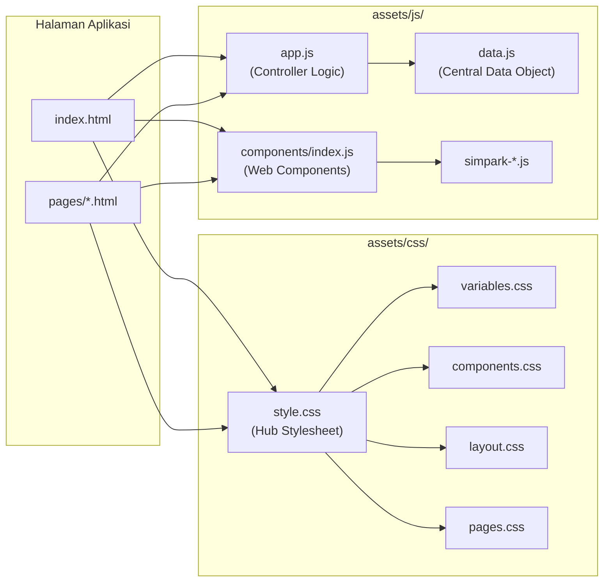

# Dokumentasi Folder: `assets/`

Folder `assets/` menyimpan seluruh sumber daya pendukung antarmuka pengguna SIMPARK-UB, mencakup stylesheet CSS bertingkat (modular tokens), kode JavaScript logika bisnis, serta pustaka Web Components kustom. Seluruh ikon dan grafis telah dioptimalkan menggunakan font ikonik modern (Bootstrap Icons) dan CSS murni tanpa ketergantungan pada file gambar statis.

---

## 🗂️ Struktur Sub-Direktori

```text
assets/
├── css/             # Lembar gaya (stylesheets) modular & variabel token desain
│   ├── README.md    # Dokumentasi arsitektur CSS & token styling
│   ├── style.css    # Main entry point stylesheet
│   ├── variables.css# Variabel warna dasar, font, dan elevation
│   ├── layout.css   # Layout grid, navbar header, dan responsive container
│   ├── components.css # Styling tombol, badge, card, modal, alert, dll
│   └── pages.css    # Styling halaman khusus (tiket QR, peta Leaflet, tabel riwayat)
└── js/              # Logika pemrograman & data aplikasi
    ├── README.md    # Dokumentasi arsitektur JavaScript, state & web components
    ├── data.js      # Objek data terpusat zona parkir
    ├── app.js       # Controller event, query parameter handler, countdown & integrasi plugin
    └── components/  # Web Components (Custom Elements) kustom
        ├── index.js # Entry file untuk mendefinisikan seluruh Web Components
        ├── simpark-header.js
        ├── simpark-input.js
        ├── simpark-badge.js
        ├── simpark-chip.js
        ├── simpark-alert.js
        ├── simpark-stat-tile.js
        ├── simpark-zone-card.js
        └── simpark-map.js
```

---

## 🔄 Diagram Keterkaitan Aset dengan Halaman



---

## 💡 Prinsip Desain Folder `assets/`

1. **Modular & Scalable**:
   CSS dan JavaScript dipecah sesuai tanggung jawabnya masing-masing (*Separation of Concerns*). Menambahkan komponen baru hanya perlu membuat 1 file komponen tanpa mengotori file lainnya.
2. **Framework-Agnostic Web Components**:
   Semua komponen UI menggunakan standar native browser Custom Elements `HTMLElement`. Tidak bergantung pada framework besar seperti React atau Vue, sehingga sangat ringan dan cepat dimuat.
3. **No-Build Architecture**:
   Setiap modul JS ditulis dengan sintaks JavaScript ES Modules (`type="module"`), langsung dieksekusi secara instan oleh browser modern.
4. **Zero Heavy Images**:
   Ikon dirender secara vektor via Bootstrap Icons CDN dan QR Code dirender dinamis via HTML5 Canvas, membuat bobot aplikasi sangat ringan.
