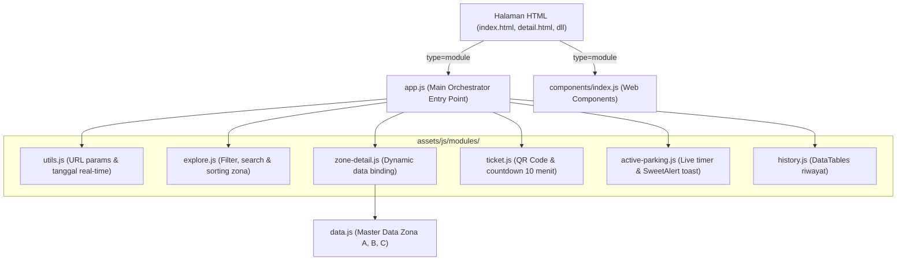

# Dokumentasi Folder: `assets/js/`

Folder `assets/js/` mengatur seluruh fungsionalitas interaktif, logika bisnis, manipulasi data dinamis, serta pendaftaran **Web Components kustom** (W3C Custom Elements API).

Semua modul ditulis menggunakan standar **ES Modules** murni tanpa build tool, dan seluruh fungsi callback ditulis menggunakan blok function standar yang mudah dibaca dan dipelihara.

---

## ⚡ Alur Data & Eksekusi Script Modular

---

## 📄 Penjelasan Modul JavaScript (`assets/js/modules/`)

Struktur JavaScript dipecah secara modular (*Separation of Concerns*):

1. **`app.js`**: Orchestrator utama yang mengimpor seluruh modul dan mengeksekusinya saat `DOMContentLoaded`.
2. **`data.js`**: Objek master database client-side (`ZONES`) yang menyimpan kuota slot, waktu, antrean, dan deskripsi masing-masing zona.
3. **`modules/utils.js`**: Helper umum seperti `getQueryParam()` dan fungsi tanggal lokal real-time `initLiveDate()`.
4. **`modules/explore.js`**: Logika filter kartu ketersediaan (*Semua, Tersedia, Terbatas, Penuh*), real-time search, sorting opsi dropdown (*Waktu, Slot, Jarak*), dan hover pin Leaflet.
5. **`modules/zone-detail.js`**: Pembaca parameter URL dan mapper data dinamis ke elemen UI di `pages/detail.html`.
6. **`modules/ticket.js`**: Generator dynamic QR Code via `QRCode.js` dan countdown timer 10 menit dengan animasi progress bar.
7. **`modules/active-parking.js`**: Live stopwatch counter durasi parkir berjalan serta pemicu notifikasi Toast SweetAlert2 saat menyimpan lokasi spesifik.
8. **`modules/history.js`**: Inisialisasi tabel riwayat parkir dinamis menggunakan DataTables.js (search, paging, dan sorting).

---

## 🧩 Folder `components/` (Web Components)

Komponen UI modular yang dibuat sebagai Custom Elements sehingga dapat digunakan langsung di HTML seperti tag HTML bawaan:

| Nama File | Tag HTML | Deskripsi & Parameter Kunci |
|---|---|---|
| [`simpark-header.js`](components/simpark-header.js) | `<simpark-header>` | Navbar atas navigasi. Atribut: `active="home\|explore\|active\|history"`, `root-path="./"`. |
| [`simpark-input.js`](components/simpark-input.js) | `<simpark-input>` | Input pencarian & dropdown kustom. Atribut: `placeholder`, `icon="search"`, `chevron="true"`, `options="..."`. |
| [`simpark-badge.js`](components/simpark-badge.js) | `<simpark-badge>` | Badge status rounded. Atribut: `tone="success\|warning\|error"`, `label="..."`. |
| [`simpark-chip.js`](components/simpark-chip.js) | `<simpark-chip>` | Filter chip interaktif. Atribut: `label="..."`, `active="true\|false"`, `data-filter="..."`. |
| [`simpark-alert.js`](components/simpark-alert.js) | `<simpark-alert>` | Banner notifikasi & peringatan. Atribut: `tone="info\|warning"`, `title="..."`, `body="..."`. |
| [`simpark-stat-tile.js`](components/simpark-stat-tile.js) | `<simpark-stat-tile>` | Ubin ringkasan metrik. Atribut: `tone="blue\|light"`, `label="..."`, `value="..."`. |
| [`simpark-zone-card.js`](components/simpark-zone-card.js) | `<simpark-zone-card>` | Kartu opsi zona parkir. Atribut: `zone-key`, `name`, `status-tone`, `estimate`, `slots`, `queue`, `href`. |
| [`simpark-map.js`](components/simpark-map.js) | `<simpark-map>` | Komponen wrapper Leaflet.js. Otomatis memusatkan peta ke kampus UB dan menampilkan pin dinamis sesuai parameter zona. |
| [`index.js`](components/index.js) | - | File hub untuk mendaftarkan semua tag di atas dengan `customElements.define(...)`. |
