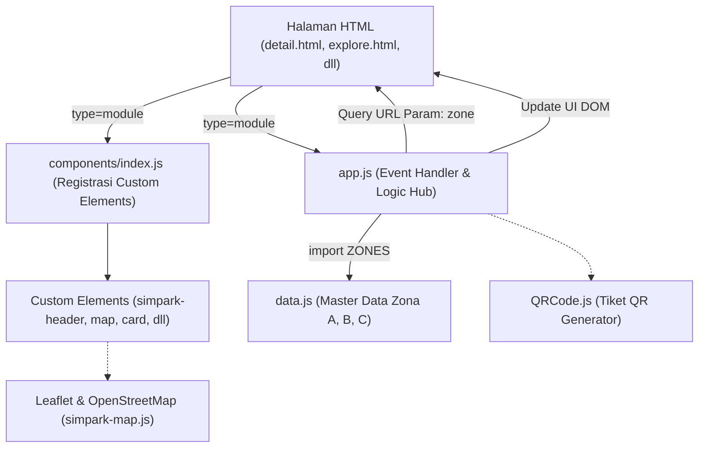

# Dokumentasi Folder: `assets/js/`

Folder `assets/js/` mengatur seluruh fungsionalitas interaktif, logika bisnis, manipulasi data dinamis, serta pendaftaran **Web Components kustom** (W3C Custom Elements API).

Semua modul ditulis menggunakan standar **ES Modules** murni tanpa build tool, dan seluruh fungsi callback ditulis menggunakan blok function standar yang mudah dibaca dan dipelihara.

---

## ⚡ Alur Data & Eksekusi Script

---

## 📄 Penjelasan File Inti

### 1. `data.js`
- **Fungsi**: Database mini di sisi klien (single source of truth) yang menyimpan rincian properti untuk masing-masing zona parkir:
  - `A`: Parkir Teknik Utara (Rekomendasi Utama, 45 slot, waktu 8 menit, antrean rendah).
  - `B`: Parkir FILKOM Selatan (Alternatif, 12 slot, waktu 9 menit, antrean sedang).
  - `C`: Parkir Gedung Rektorat (Penuh, 0 slot, waktu 11 menit, antrean tinggi).
- **Properti yang Disediakan**: Nama lengkap, status tone warna badge, total kapasitas & sisa slot, antrean, deskripsi alasan rekomendasi, gedung tujuan, serta objek `breakdown` waktu perjalanan.

### 2. `app.js`
- **Fungsi**: Pusat controller logika halaman yang dieksekusi saat event `DOMContentLoaded`.
- **Fungsi Utama**:
  - `getQueryParam(param)`: Mengambil nilai parameter dari query string URL browser (`window.location.search`).
  - `initZoneDetail()`: Membaca parameter `?zone=...` dan memetakan data dari `data.js` ke seluruh elemen teks, badge rekomendasi, ubin statistik, dan modal di halaman [pages/detail.html](../pages/detail.html).
  - `initExploreFilters()`: Menangani filter chip status ketersediaan pada halaman pencarian serta event `mouseenter` pada kartu zona untuk memicu sorotan pin di peta Leaflet.
  - `initTicketCountdown()`: Menjalankan timer hitung mundur 10 menit untuk masa berlaku tiket dengan kalkulasi menit:detik dan pembaruan lebar progress bar.
  - `initDynamicQRCode()`: Mengonstruksi payload QR dinamis berformat `SIMPARK-UB:{ID}:{ZONA}:{TIMESTAMP}` dan merendernya ke kontainer QR canvas.
  - `initHistoryDataTable()`: Mengaktifkan fungsionalitas pencarian, pagination, dan translasi bahasa Indonesia pada tabel riwayat transaksi via DataTables.

---

## 🧩 Folder `components/` (Web Components)

Komponen UI modular yang dibuat sebagai Custom Elements sehingga dapat digunakan langsung di HTML seperti tag HTML bawaan:

| Nama File | Tag HTML | Deskripsi & Parameter Kunci |
|---|---|---|
| [`simpark-header.js`](components/simpark-header.js) | `<simpark-header>` | Navbar atas navigasi. Atribut: `active="home\|explore\|active\|history"`, `root-path="./"`. |
| [`simpark-input.js`](components/simpark-input.js) | `<simpark-input>` | Input pencarian & dropdown kustom. Atribut: `placeholder`, `icon="search"`, `chevron="true"`, `options="..."`. |
| [`simpark-badge.js`](components/simpark-badge.js) | `<simpark-badge>` | Badge status rounded. Atribut: `tone="success\|warning\|error"`, `label="..."`. |
| [`simpark-chip.js`](components/simpark-chip.js) | `<simpark-chip>` | Filter chip interaktif. Atribut: `label="..."`, `active="true\|false"`, `data-filter="..."`. |
| [`simpark-alert.js`](components/simpark-alert.js) | `<simpark-alert>` | Banner notifikasi & peringatan. Atribut: `tone="info\|warning"`, `title="..."`, `body="..."`. |
| [`simpark-stat-tile.js`](components/simpark-stat-tile.js) | `<simpark-stat-tile>` | Ubin ringkasan metrik. Atribut: `tone="blue\|light"`, `label="..."`, `value="..."`. |
| [`simpark-zone-card.js`](components/simpark-zone-card.js) | `<simpark-zone-card>` | Kartu opsi zona parkir. Atribut: `zone-key`, `name`, `status-tone`, `estimate`, `slots`, `queue`, `href`. |
| [`simpark-map.js`](components/simpark-map.js) | `<simpark-map>` | Komponen wrapper Leaflet.js. Otomatis memusatkan peta ke kampus UB dan menampilkan pin dinamis sesuai parameter zona. |
| [`index.js`](components/index.js) | - | File hub untuk mendaftarkan semua tag di atas dengan `customElements.define(...)`. |
