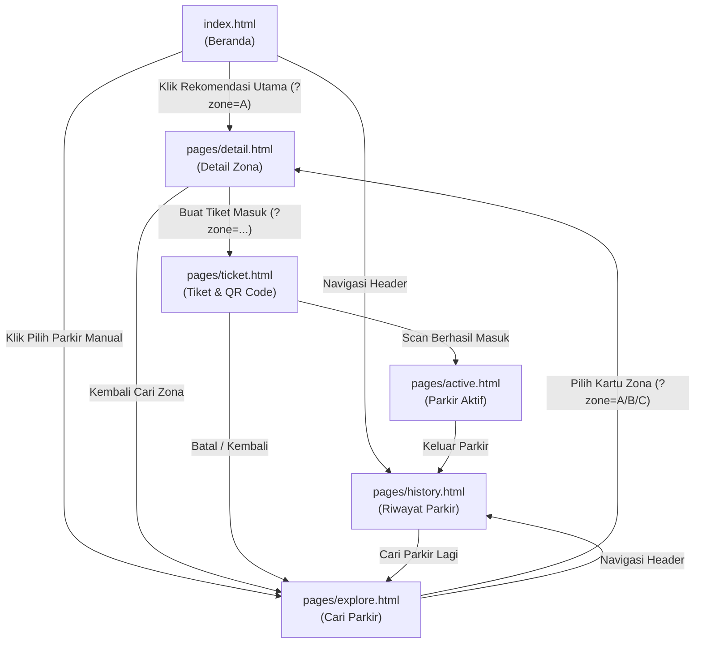

# Dokumentasi Folder: `pages/`

Folder `pages/` berisi seluruh sub-halaman aplikasi antarmuka SIMPARK-UB. Arsitektur halaman menggunakan pola **Multi-Page Application (MPA)** yang statis namun dinamis berkat integrasi Web Components dan pembacaan parameter URL via JavaScript ES Modules.

---

## 🗺️ Diagram Keterkaitan & Alur Halaman (User Flow)

---

## 📄 Rincian Setiap Halaman & Hubungannya dengan File Lain

### 1. `explore.html` (Cari Parkir)
- **Fungsi**: Menampilkan daftar semua zona parkir yang tersedia di sekitar gedung tujuan, filter status (*Semua, Tersedia, Terbatas, Penuh*), dropdown pengurutan, serta peta interaktif seluruh kampus UB.
- **Keterkaitan**:
  - Mengimpor Web Components via [`../assets/js/components/index.js`](../assets/js/components/index.js) (`<simpark-header>`, `<simpark-input>`, `<simpark-chip>`, `<simpark-zone-card>`, `<simpark-map>`, `<simpark-alert>`).
  - Menggunakan [`../assets/js/app.js`](../assets/js/app.js) untuk filtering kartu zona dan interaktivitas peta.
  - Setiap kartu zona di halaman ini memiliki tautan menuju `detail.html?zone={key}` (misal: `detail.html?zone=A`).

---

### 2. `detail.html` (Detail Zona)
- **Fungsi**: Halaman rincian tunggal modular yang datanya berubah secara otomatis menyesuaikan zona yang dipilih (`zone=A`, `zone=B`, atau `zone=C`).
- **Data yang Ditampilkan**:
  - Nama zona dan status kuota slot.
  - Badge Rekomendasi (aktif khusus Zona A).
  - Peta fokus zona spesifik (`<simpark-map>`).
  - Rincian estimasi waktu (*perjalanan, antrean gerbang, cari slot, jalan kaki ke gedung tujuan*).
  - Modal konfirmasi pembuatan tiket masuk.
- **Keterkaitan**:
  - Membaca parameter query URL melalui fungsi `initZoneDetail()` di [`../assets/js/app.js`](../assets/js/app.js).
  - Mengambil data properti zona dari [`../assets/js/data.js`](../assets/js/data.js).
  - Meneruskan `zone` ke tombol konfirmasi tiket: `ticket.html?zone={key}`.

---

### 3. `ticket.html` (Tiket Parkir & QR Code)
- **Fungsi**: Menampilkan e-tiket sementara yang valid selama 10 menit dengan QR code interaktif dan instruksi pintu masuk gerbang parkir.
- **Fitur Interaktif**:
  - Generator QR code dinamis menggunakan library `QRCode.js`.
  - Countdown timer 10 menit mundur dengan animasi progress bar.
  - Tombol simulasi skenario: *Scan Berhasil Masuk* (menuju `active.html`) dan *Scan Gagal (Kedaluwarsa)* (menampilkan modal feedback kegagalan).
- **Keterkaitan**:
  - Memanggil `initDynamicQRCode()` dan `initTicketCountdown()` di [`../assets/js/app.js`](../assets/js/app.js).
  - Menggunakan komponen UI `<simpark-header>` dan styling khusus tiket di [`../assets/css/pages.css`](../assets/css/pages.css).

---

### 4. `active.html` (Parkir Aktif)
- **Fungsi**: Menampilkan status saat kendaraan pengguna telah berhasil masuk dan tercatat di area parkir. Dapat diakses langsung melalui menu navigasi *"Parkiran Aktif"* di navbar.
- **State Dinamis (Dua Kondisi)**:
  - **State Kosong**: Tampil saat pengguna belum memiliki tiket atau belum scan masuk. Dilengkapi kartu panduan dan tombol menuju Cari Parkir.
  - **State Aktif**: Otomatis aktif setelah menekan *"Scan Berhasil Masuk"*, menampilkan zona parkir yang ditempati, ID tiket unik, jam masuk, dan peta lokasi yang otomatis terpusat pada zona terkait.
- **Fitur Interaktif**:
  - Live stopwatch durasi parkir yang terus bertambah detik demi detik.
  - Peta lokasi area parkir aktif (`<simpark-map>`).
  - Formulir catatan lokasi spesifik dengan tombol simpan memicu **Toast Notifikasi SweetAlert2**.
  - Tombol tindakan *"Keluar Parkir"* yang memicu modal konfirmasi selesai parkir dan mereset sesi aktif di `localStorage`.
- **Keterkaitan**:
  - Menggunakan komponen `<simpark-header active="active">`, `<simpark-map>`, dan `<simpark-stat-tile>`.
  - Diatur oleh modul [`../assets/js/modules/active-parking.js`](../assets/js/modules/active-parking.js).
  - Terhubung ke `history.html` setelah proses parkir ditutup.

---

### 5. `history.html` (Riwayat Parkir)
- **Fungsi**: Menampilkan rekapitulasi histori parkir yang pernah dilakukan pengguna lengkap dengan tanggal, zona, durasi, dan status.
- **Fitur Interaktif**:
  - Integrasi tabel dinamis dengan **DataTables.js** (pencarian instan, sorting kolom, dan pagination).
  - Rangkuman total jam parkir dan efisiensi waktu melalui `<simpark-stat-tile>`.
- **Keterkaitan**:
  - Menginisialisasi DataTable melalui `initHistoryDataTable()` di [`../assets/js/app.js`](../assets/js/app.js).
  - Memuat file CSS DataTable dan Bootstrap 5 table styling.
